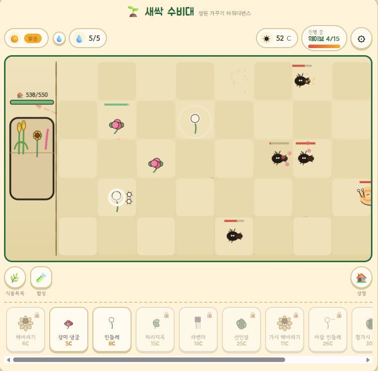

[🎮 새싹 수비대 플레이하기](/assets/새싹수비대.html)



# 새싹 수비대 🌱

밭에 **식물을 심어** 몰려오는 **벌레로부터 정원을 지키는** 타워디펜스 게임입니다. **15개 웨이브**를 버티면 승리하고, 정원 체력이 0이 되면 패배합니다. 날씨·물 주기·합성·강화 요소로 "관리하는 재미"를 더했습니다.

| 항목 | 내용 |
|---|---|
| 개발 기간 | 2026.08.28 ~ 2026.09.01 |
| 팀 구성 | 1인 |
| 담당 | 바이브 코딩 명령 프롬프트 작성, 디자인 명령 프롬프트 작성 |
| 기술 | HTML, CSS, JavaScript (Canvas) |

이 글은 코드를 읽기만 하는 게 아니라, **실습 7개**로 나눠서 **직접 따라 만들고 숫자를 바꿔보는** 방식으로 정리했습니다. 각 실습은 `목표 → 게임 코드 → 직접 해보기` 순서입니다.

## 게임 규칙 한눈에 보기

| 항목 | 내용 |
|---|---|
| 밭 크기 | 5줄 × 8칸 |
| 시작 코인 / 정원 체력 | 10 코인 / 550 |
| 처음 쓸 수 있는 식물 | 장미 덩굴, 민들레 (나머지는 상점에서 구매) |
| 식물 종류 | 기본 6종 + 합성 5종 |
| 벌레 종류 | 개미, 달팽이, 나비, 메뚜기 + 최종 보스 지렁이 |
| 날씨 | 맑음 ☀️ / 비 🌧️ / 가뭄 🌵 |
| 승리 / 패배 | 15웨이브 클리어 / 정원 체력 0 |

---

## 실습 1. 캔버스에 5×8 밭 그리기

**목표:** 화면 크기에 맞춰 칸 크기를 계산하고, 클릭한 위치가 **몇 번째 줄, 몇 번째 칸인지** 알아낸다.

### 게임 코드

```javascript
const ROWS=5, COLS=8;
const HOUSE_W_RATIO=1.35; // 왼쪽 집이 칸 1.35개만큼 자리를 차지

function resizeCanvas(){
  const rect=$("fieldWrap").getBoundingClientRect();
  CW=rect.width; CH=rect.height;
  const dpr=Math.min(window.devicePixelRatio||1,2);
  cvs.width=Math.round(CW*dpr); cvs.height=Math.round(CH*dpr);
  ctx.setTransform(dpr,0,0,dpr,0,0);
  TS=Math.min(CW/(COLS+HOUSE_W_RATIO), CH/ROWS);   // 칸 크기
  HOUSE_W=TS*HOUSE_W_RATIO;
  FOY=(CH-TS*ROWS)/2;                               // 밭의 시작 y
  FOX=HOUSE_W + Math.max(0,(CW-HOUSE_W-TS*COLS)/2); // 밭의 시작 x
}

function gx(c){ return FOX + c*TS; }   // 칸 번호 → 픽셀 x
function gy(r){ return FOY + r*TS; }   // 줄 번호 → 픽셀 y
function tileAt(px,py){                // 픽셀 → [줄, 칸]
  const c=Math.floor((px-FOX)/TS), r=Math.floor((py-FOY)/TS);
  if(r<0||r>=ROWS||c<0||c>=COLS) return null;
  return [r,c];
}
```

* **칸 크기(`TS`)** 는 가로·세로 중 **더 빡빡한 쪽**에 맞춥니다. 그래서 화면이 어떻게 바뀌어도 칸이 정사각형으로 유지됩니다.
* **`devicePixelRatio`** 만큼 캔버스 해상도를 키워서 고해상도 화면에서도 흐릿하지 않게 그립니다.
* `gx/gy`(칸 → 픽셀)와 `tileAt`(픽셀 → 칸)은 **서로 반대 방향 변환**입니다. 이 둘만 있으면 그리기와 클릭 처리를 모두 할 수 있습니다.

### 직접 해보기

아래 코드를 `.html` 파일로 저장하고 열어보세요. 칸을 클릭하면 콘솔(F12)에 좌표가 찍힙니다.

```html
<meta charset="utf-8">   <!-- 한글이 깨지지 않게 -->
<canvas id="c" width="640" height="400" style="border:1px solid #ccc"></canvas>
<script>
const ROWS=5, COLS=8, TS=80;
const ctx=document.getElementById('c').getContext('2d');

for(let r=0;r<ROWS;r++) for(let c=0;c<COLS;c++){
  ctx.fillStyle=(r+c)%2 ? '#EAE0C4' : '#F6EFDD';   // 체크무늬
  ctx.fillRect(c*TS, r*TS, TS, TS);
}

document.getElementById('c').addEventListener('click', e=>{
  const c=Math.floor(e.offsetX/TS), r=Math.floor(e.offsetY/TS);
  console.log(`${r}번째 줄, ${c}번째 칸`);
});
</script>
```

* **과제 1:** `ROWS`, `COLS`를 바꿔서 6×10 밭을 만들어 보기
* **과제 2:** 클릭한 칸을 초록색으로 칠해 보기

<details markdown="1">
<summary>과제 2 힌트</summary>

클릭 이벤트 안에서 `ctx.fillStyle='#8FCB7C'; ctx.fillRect(c*TS, r*TS, TS, TS);` 를 실행하면 됩니다.

</details>

---

## 실습 2. 식물을 "데이터"로 정의하고 심기

**목표:** 식물의 능력치를 **객체 하나에 모아두고**, 심기 함수는 그 데이터만 읽어서 동작하게 만든다.

### 게임 코드 — 식물 데이터

```javascript
const PLANTS = {
  rose:{id:"rose",name:"장미 덩굴",cost:5,hp:100,range:3,atk:9,atkSpeed:1.2,maxTargets:2,
    kind:"melee", desc:"뻗어나간 가시덩굴로 3칸 앞, 동시에 2마리까지 찔러요."},
  dandelion:{id:"dandelion",name:"민들레",cost:8,hp:70,range:5,atk:15,atkSpeed:1.15,
    proj:true,projSpeed:6.5,maxTargets:3, kind:"ranged"},
  cactus:{id:"cactus",name:"선인장",cost:25,hp:280,range:1,atk:27,atkSpeed:1.1,maxTargets:1,
    kind:"wall", desc:"튼튼한 방벽으로 길을 막고 강하게 반격해요."},
  // ... 해바라기, 파리지옥, 라벤더, 합성 식물 5종
};
```

| 식물 | 가격 | 체력 | 사거리 | 공격력 | 역할 (`kind`) |
|---|---|---|---|---|---|
| 해바라기 | 6 | 80 | - | - | support (코인 생산 + 버프) |
| 장미 덩굴 | 5 | 100 | 3 | 9 | melee |
| 민들레 | 8 | 70 | 5 | 15 | ranged (투사체) |
| 파리지옥 | 15 | 120 | 2 | 20 | trap (가두기) |
| 라벤더 | 18 | 90 | 4 | 10 | control (둔화·넉백) |
| 선인장 | 25 | 280 | 1 | 27 | wall (길 막기) |

### 게임 코드 — 심기

```javascript
function tryPlant(r,c,id){
  const cell=G.grid[r][c];
  const def=PLANTS[id];
  if(cell.plant){ showToast("이미 식물이 심어져 있어요."); return; }
  if(!G.unlockedPlants.includes(id)){ showToast("상점에서 먼저 구매해야 해요."); return; }
  if(G.coins<def.cost){ showToast("코인이 부족해요."); return; }
  G.coins-=def.cost;
  const hpMax=effHpMax(def);   // 강화 레벨이 반영된 최대 체력
  cell.plant={type:id,hp:hpMax,hpMax,cd:0,ultCd:6,vigor:100,trapped:null,phase:Math.random()*10};
  updateHUD();
}
```

* **안 되는 경우를 먼저 걸러내고(`return`)**, 통과하면 코인을 빼고 심습니다.
* 칸에는 식물 전체가 아니라 **`type`(어떤 식물인지)과 현재 상태**(체력, 쿨타임, 활력)만 저장합니다. 능력치는 필요할 때 `PLANTS[type]`에서 꺼내 씁니다.

### 강화와 합성도 데이터로

```javascript
const ATK_UP_PCT=0.15, HP_UP_PCT=0.2; // 레벨당 공격력 +15%, 체력 +20%
function effAtk(def){ const lvl=(G.plantUpgrades[def.id]&&G.plantUpgrades[def.id].atk)||0; return def.atk*(1+ATK_UP_PCT*lvl); }

// 합성 식물은 recipe만 적어두면 합성 화면이 자동으로 만들어짐
thornSun:{ name:"가시 해바라기", cost:11, recipe:["sunflower","rose"], ... }
```

| 합성 결과 | 재료 |
|---|---|
| 가시 해바라기 | 해바라기 + 장미 덩굴 |
| 바람 민들레 | 민들레 + 라벤더 |
| 철가시 선인장 | 장미 덩굴 + 선인장 |
| 안개 파리지옥 | 파리지옥 + 라벤더 |
| 포자 지옥 | 민들레 + 파리지옥 |

### 직접 해보기

[게임 파일](/assets/새싹수비대.html)을 내려받아 `PLANTS`를 수정해 보세요.

* **과제 1:** 장미 덩굴의 `cost`를 `5 → 1`로 바꾸고 플레이해 보기 (밸런스가 어떻게 무너지는지 체감)
* **과제 2:** 민들레의 `maxTargets`를 `3 → 1`로 바꾸면 웨이브 몇까지 버틸 수 있는지 비교하기
* **과제 3:** `recipe`가 있는 새 합성 식물을 하나 추가하고 `RECIPES`, `PLANT_ORDER` 배열에도 id 넣어보기

---

## 실습 3. 게임 루프 만들기

**목표:** `requestAnimationFrame`으로 매 프레임 **업데이트 → 그리기**를 반복하고, 웨이브를 **상태 3단계**로 관리한다.

### 게임 코드

```javascript
let lastT=performance.now();
function loop(now){
  const rawDt=Math.min(0.05,(now-lastT)/1000); lastT=now;  // 지난 프레임 이후 흐른 시간(초)
  let dt=rawDt;
  if(!G.paused && !G.over){
    if(G.waveState==="prep"){                 // ① 준비: 5초 카운트다운
      G.waveTimer-=dt;
      if(G.waveTimer<=0) startWave();
    } else if(G.waveState==="spawning"){      // ② 소환: 시간표대로 벌레 등장
      G.spawnTimer+=dt;
      while(G.spawnQueue.length && G.spawnQueue[0].t<=G.spawnTimer){
        const s=G.spawnQueue.shift(); spawnBug(s.type,s.mult);
      }
      if(!G.spawnQueue.length) G.waveState="clearing";
    } else if(G.waveState==="clearing"){      // ③ 정리: 남은 벌레를 다 잡으면 다음 웨이브
      if(G.bugs.length===0){
        if(G.wave>=TOTAL_WAVES){ triggerGameOver(true); }
        else { G.coins+=6; G.wave++; G.waveState="prep"; G.waveTimer=5; }
      }
    }
    updatePlants(dt); updateProjectiles(dt); updateBugs(dt); updateParticles(dt);
  }
  render(now/1000);
  requestAnimationFrame(loop);
}
```

```
 prep (5초) ──▶ spawning (소환) ──▶ clearing (남은 벌레 처리) ──▶ 다음 웨이브 prep
                                          │
                                   15웨이브면 승리
```

* **`dt`(델타 타임)** 를 곱해서 움직이기 때문에 **모니터 주사율(60Hz/144Hz)이 달라도 게임 속도가 같습니다.**
* `Math.min(0.05, ...)`로 dt 최댓값을 막아서, 탭을 오래 비웠다 돌아와도 **벌레가 순간이동하지 않습니다.**
* 일시정지는 업데이트만 건너뛰고 **그리기(`render`)는 계속** 하는 방식입니다.

### 직접 해보기

```html
<meta charset="utf-8">
<canvas id="c" width="600" height="100"></canvas>
<script>
const ctx=document.getElementById('c').getContext('2d');
let x=600, speed=120, last=performance.now();   // speed: 초당 120px

function loop(now){
  const dt=Math.min(0.05,(now-last)/1000); last=now;
  x-=speed*dt;                 // dt를 곱해서 이동
  if(x<0) x=600;
  ctx.clearRect(0,0,600,100);
  ctx.fillStyle='#3B2A20';
  ctx.beginPath(); ctx.arc(x,50,12,0,Math.PI*2); ctx.fill();  // 개미 🐜
  requestAnimationFrame(loop);
}
requestAnimationFrame(loop);
</script>
```

* **과제 1:** `x-=speed*dt` 를 `x-=2` 로 바꾸고, 주사율이 다른 모니터나 다른 기기에서 속도가 달라지는지 확인하기
* **과제 2:** 스페이스바를 누르면 멈추는 일시정지 기능 만들기 (업데이트만 멈추고 그리기는 유지)

---

## 실습 4. 벌레 이동과 타겟 찾기

**목표:** 벌레는 오른쪽에서 왼쪽 집으로 걸어오고, 식물은 **사거리 안에서 우선순위가 높은 벌레**를 골라 공격한다.

### 게임 코드 — 타겟 찾기

```javascript
function findTargets(r,c,def,maxN){
  const found=[];
  for(const b of G.bugs){
    if(b.burrowed) continue;                     // 땅속에 숨은 벌레는 제외
    const rowDiff=Math.abs(b.row-r);
    if(rowDiff>1) continue;                      // 같은 줄 또는 바로 위·아래 줄만
    const effRange = rowDiff===0 ? def.range : Math.max(1,def.range-1); // 대각선은 1칸 짧게
    const dist=b.x-c;
    if(dist< -0.3) continue;                     // 이미 지나간 벌레는 제외
    if(dist>effRange+0.6) continue;              // 사거리 밖
    found.push(b);
  }
  // 같은 줄 먼저 → 그다음 집에 가까운 순서
  found.sort((a,b)=> (Math.abs(a.row-r)-Math.abs(b.row-r)) || (a.x-b.x));
  return found.slice(0,maxN);                    // 동시 공격 수만큼만
}
```

* `sort`에서 `||` 를 쓰면 **첫 기준이 같을 때만 두 번째 기준으로** 비교합니다. (같은 줄 우선 → 가까운 순)
* `slice(0, maxN)`으로 **장미는 2마리, 민들레는 3마리**까지 동시에 공격합니다.

### 게임 코드 — 벌레 이동

```javascript
function updateBugs(dt){
  for(let i=G.bugs.length-1;i>=0;i--){          // 뒤에서부터 돌아야 splice해도 안전
    const b=G.bugs[i]; const def=BUGS[b.type];
    if(b.hp<=0){ G.coins+=def.coin; G.bugs.splice(i,1); continue; }   // 처치 → 코인
    if(b.trapped>0){ b.trapped-=dt; continue; }                        // 파리지옥에 갇힘
    let sp=b.speed;
    if(b.slow>0){ b.slow-=dt; sp*=0.5; }                               // 둔화
    b.x-=sp*dt;
    if(b.x<= -0.3){                                                    // 집 도착
      G.gardenHP=Math.max(0,G.gardenHP-def.atk);
      G.bugs.splice(i,1);
      if(G.gardenHP<=0){ triggerGameOver(false); return; }
    }
  }
}
```

| 벌레 | 체력 | 속도 | 특징 |
|---|---|---|---|
| 개미 | 28 | 1.55 | 4~6마리 떼로 등장 |
| 달팽이 | 130 | 0.55 | 느리지만 단단함 |
| 나비 | 90 | 1.25 | 14% 확률로 공격 회피 |
| 메뚜기 | 80 | 1.9 | 가장 빠름, 점프 |
| 지렁이 (보스) | 550 | 0.75 | 마지막 웨이브에만 등장, 땅속으로 숨음 |

* 배열을 돌면서 `splice`로 지울 때는 **뒤에서부터(`i--`)** 돌아야 인덱스가 꼬이지 않습니다.
* 요구사항이었던 **"몹마다 체력이 달라야 한다"** 를 `BUGS` 데이터로 해결했습니다.

### 직접 해보기

* **과제 1:** `findTargets`의 정렬을 `(a,b)=> b.hp - a.hp` 로 바꿔서 **체력이 가장 많은 벌레부터** 노리게 해보기
* **과제 2:** `for` 문을 `i=0`부터 `i++`로 바꾸면 어떤 버그가 생기는지 생각해 보기

<details markdown="1">
<summary>과제 2 답</summary>

앞에서부터 돌다가 `splice(i,1)`로 하나를 지우면 뒤 요소들이 한 칸씩 당겨집니다. 그 상태에서 `i++`가 되면 **바로 다음 벌레 하나를 건너뛰게** 됩니다. 그 프레임에서는 그 벌레가 움직이지 않습니다.

</details>

---

## 실습 5. 웨이브 난이도 설계

**목표:** 웨이브 번호만 넣으면 **벌레 출현 시간표**가 만들어지게 하고, 웨이브가 올라갈수록 자연스럽게 어려워지게 한다.

### 게임 코드

```javascript
function buildWaveQueue(wave){
  const q=[];
  const mult=1+(wave-1)*0.16;              // 웨이브마다 벌레 체력·공격력 +16%
  const baseN=Math.round(2.5+wave*0.85);   // 벌레 수도 조금씩 증가

  // 웨이브가 오를수록 벌레 종류가 하나씩 풀림 (1~3웨이브는 개미만)
  const weights={ ant: Math.max(1, 5-wave*0.3) };
  if(wave>=4) weights.snail       = Math.min(4, 0.4+(wave-3)*0.3);
  if(wave>=6) weights.butterfly   = Math.min(4, 0.3+(wave-5)*0.3);
  if(wave>=8) weights.grasshopper = Math.min(4, 0.3+(wave-7)*0.3);

  // 가중치만큼 "뽑기 통"에 넣기
  const pool=[];
  for(const type in weights){
    const n=Math.max(1,Math.round(weights[type]*4));
    for(let i=0;i<n;i++) pool.push(type);
  }
  // ... pool에서 무작위로 뽑아 출현 시간(t)과 함께 q에 넣음

  if(wave>=TOTAL_WAVES){ q.push({type:"earthworm",t:t+2,mult}); }  // 마지막엔 보스
  q.sort((a,b)=>a.t-b.t);
  return q;
}
```

| 웨이브 | 벌레 수 (대략) | 강화 배율 | 새로 나오는 벌레 |
|---|---|---|---|
| 1 | 3 | ×1.00 | 개미 |
| 4 | 6 | ×1.48 | 달팽이 |
| 6 | 8 | ×1.80 | 나비 |
| 8 | 9 | ×2.12 | 메뚜기 |
| 15 | 15 + 보스 | ×3.24 | 지렁이 👑 |

* **"뽑기 통(pool)"** 방식: 가중치가 큰 벌레를 통에 여러 개 넣고 무작위로 하나 꺼내면, 자연스럽게 **그 벌레가 더 자주** 나옵니다.
* 개미 가중치는 웨이브가 오를수록 **줄고**, 다른 벌레는 **늘어서** 후반엔 구성이 다양해집니다.
* 출현 간격도 `Math.max(0.5, 1.1-wave*0.03)`으로 점점 **촘촘해집니다.**

### 직접 해보기

게임 코드는 전체가 `(function(){ ... })();` 로 감싸져 있습니다. **즉시 실행 함수(IIFE)** 라고 부르는데, 변수와 함수가 전역에 새어 나가지 않게 막아줍니다. 그래서 콘솔에서 `buildWaveQueue`를 바로 부를 수 없습니다.

내려받은 게임 파일 맨 아래 `})();` **바로 위에** 아래 한 줄을 추가해서 함수를 꺼내 주세요.

```javascript
window.buildWaveQueue = buildWaveQueue;   // 콘솔에서 쓸 수 있게 전역으로 꺼내기
```

그다음 게임을 열고 콘솔(F12)에서 아래 코드를 실행해 보세요.

```javascript
// 웨이브별로 어떤 벌레가 몇 마리 나오는지 확인
for(const w of [1,5,10,15]){
  const count={};
  buildWaveQueue(w).forEach(s=>count[s.type]=(count[s.type]||0)+1);
  console.log(`웨이브 ${w}`, count);
}
```

* **과제 1:** `0.16`을 `0.3`으로 바꾸면 몇 웨이브에서 막히는지 확인하기
* **과제 2:** 10웨이브에 **중간 보스**로 지렁이가 나오게 조건 추가해 보기

---

## 실습 6. 날씨와 물 주기

**목표:** 날씨에 따라 식물의 **활력(vigor)** 이 오르내리고, 시든 식물은 약해지게 만든다. 플레이어는 **물뿌리개**로 관리한다.

### 게임 코드

```javascript
function rollWeather(){
  const r=Math.random();
  if(G.wave>=3 && r<0.15){ G.weather="drought"; }   // 3웨이브부터 15% 가뭄
  else if(r<0.35){ G.weather="rain"; }              // 비
  else { G.weather="sunny"; }                       // 맑음
  G.weatherTimer=30+Math.random()*10;               // 30~40초마다 바뀜
  if(G.weather==="rain"){ G.waterCharges=G.waterMax; } // 비 오면 물뿌리개 가득
}

// updatePlants 안에서 매 프레임
if(G.weather==="drought") p.vigor=Math.max(0,p.vigor-dt*3.2);   // 가뭄: 감소
else if(G.weather==="rain") p.vigor=Math.min(100,p.vigor+dt*8); // 비: 빠르게 회복
else p.vigor=Math.min(100,p.vigor+dt*1.2);                      // 맑음: 천천히 회복
const wilted=p.vigor<40;
const potency = wilted?0.5:1;     // 시들면 공격력·코인 생산 절반

function waterPlant(r,c){
  if(G.waterCharges<=0){ showToast("물뿌리개 충전이 없어요."); return; }
  G.grid[r][c].plant.vigor=100; G.waterCharges--;
  showToast("물을 줬어요! 💧");
}
```

| 날씨 | 활력 변화 (초당) | 효과 |
|---|---|---|
| ☀️ 맑음 | +1.2 | 천천히 회복 |
| 🌧️ 비 | +8 | 빠르게 회복, 물뿌리개 가득 충전 |
| 🌵 가뭄 | −3.2 | 약 19초 만에 시듦 (활력 40 미만) |

* 물뿌리개는 최대 5회이고 **14초마다 1회 충전**됩니다.
* 가뭄에는 **어느 식물에 물을 줄지 고르는 판단**이 필요해져서, 단순히 심고 기다리는 게임이 아니게 됩니다.

### 직접 해보기

* **과제 1:** 가뭄 확률 `0.15`를 `0.5`로 올려서 물뿌리개가 얼마나 부족해지는지 체감하기
* **과제 2:** 새 날씨 `"wind"`를 추가해서, 바람이 불면 **투사체 속도가 1.5배**가 되게 만들어 보기

---

## 실습 7. 저장하고 이어하기

**목표:** 게임 상태를 `localStorage`에 저장하고, 새로고침해도 **이어서** 할 수 있게 한다.

### 게임 코드

```javascript
const SAVE_KEY="gardenTD_save_v1";

function saveGame(){
  const s=JSON.parse(JSON.stringify(G));        // 깊은 복사
  s.bugs=[]; s.projectiles=[]; s.particles=[];  // 전투 중인 것들은 저장 안 함
  localStorage.setItem(SAVE_KEY, JSON.stringify(s));
}

function loadGame(){
  const raw=localStorage.getItem(SAVE_KEY);
  if(!raw) return false;
  const s=JSON.parse(raw);
  s.bugs=[]; s.projectiles=[]; s.particles=[]; s.paused=false;
  if(!s.plantUpgrades) s.plantUpgrades={};                        // 옛 저장 파일 호환
  if(s.waveState==="spawning") s.waveState="prep", s.waveTimer=5; // 소환 중이었으면 준비부터
  G=s;
  return true;
}
```

* 게임의 모든 상태가 **`G` 객체 하나**에 있어서 `JSON.stringify` 한 번으로 저장할 수 있습니다.
* **벌레·투사체·파티클은 저장하지 않습니다.** 날아가던 홀씨 위치까지 복원하는 건 복잡하고 의미도 적어서, 대신 **웨이브를 준비 단계로 되돌립니다.**
* 나중에 추가된 `plantUpgrades`가 없는 **옛날 저장 파일도 깨지지 않게** 기본값을 채워 넣습니다. 키 이름에 `_v1`을 붙인 것도 저장 형식 버전 관리를 위해서입니다.

### 직접 해보기

1. 게임을 몇 웨이브 진행한 뒤 F12 → **Application → Local Storage** 에서 `gardenTD_save_v1` 값을 열어보기
2. 콘솔에서 코인을 바꿔보기 (치트 체험 😎)

```javascript
const s=JSON.parse(localStorage.getItem("gardenTD_save_v1"));
s.coins=999;
localStorage.setItem("gardenTD_save_v1", JSON.stringify(s));
location.reload();   // 새로고침 후 시작 화면에서 '이어하기'
```

* **과제:** 지금은 설정의 **'저장 후 나가기'** 를 눌러야만 저장됩니다. **웨이브를 클리어할 때마다 자동 저장**되게 바꿔 보기 (힌트: 실습 3의 `clearing` 단계)

---

## 요구사항 체크

| 요구사항 | 결과 | 구현 위치 |
|---|---|---|
| 식물을 심고 구매·강화할 수 있다 | ✅ | `tryPlant`, 상점(구매·강화), 합성 |
| 각 몹들의 체력이 각각 달라야 한다 | ✅ | `BUGS` 데이터 + 웨이브 배율 `mult` |
| 15웨이브를 막으면 승리, 정원 체력이 0이 되면 패배 | ✅ | `loop`의 `clearing` 단계, `updateBugs` |
| 게임을 저장하고 이어할 수 있다 | ✅ | `saveGame` / `loadGame` |

## 아쉬운 점과 개선 아이디어

* 코드가 **HTML 파일 하나(약 1,400줄)** 에 모두 들어 있어서, 기능이 늘어날수록 찾기 어렵습니다. `data.js`, `combat.js`, `render.js`처럼 파일을 나누면 좋겠습니다.
* 벌레 출현과 날씨가 `Math.random()`이라 **같은 상황을 다시 재현하기 어렵습니다.** 시드(seed) 기반 난수를 쓰면 버그 재현과 밸런스 테스트가 쉬워집니다.
* 저장이 **브라우저 `localStorage`에만** 되어 있어서 다른 기기에서는 이어서 할 수 없습니다.
* 바이브 코딩으로 만들면서, **요구사항을 구체적인 숫자와 조건으로 적어야** 원하는 결과가 나온다는 걸 배웠습니다. ("벌레가 점점 세진다" 보다 "웨이브마다 체력 16% 증가"처럼)
