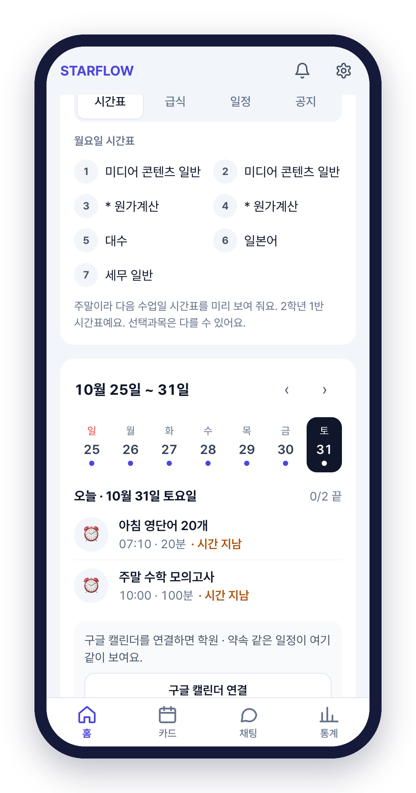
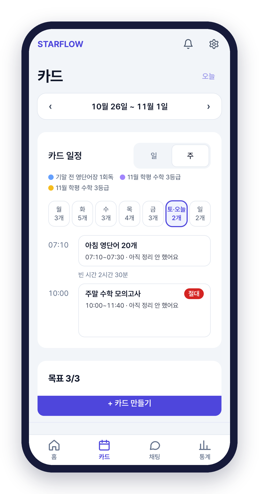
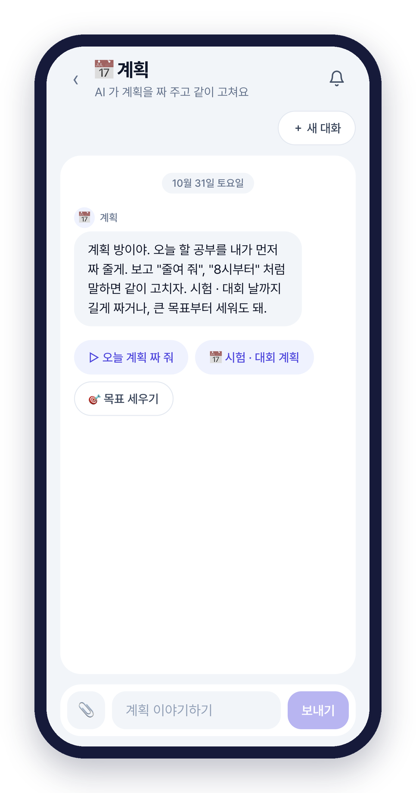
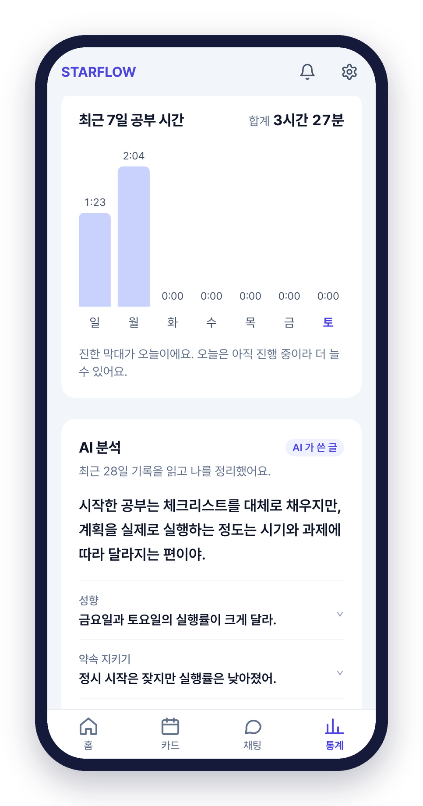

[🌟 STARFLOW 써 보기](https://project-fe-eosin.vercel.app)

# STARFLOW ⭐

**공부할 때 옆에서 챙겨 주는 AI 비서**다. 내가 쌓아 온 공부 기록을 보고 나한테 맞는 공부 방법을 찾아 주고, 그 방법대로 꾸준히 공부할 수 있게 도와주는 웹 서비스다. TMAX IT 희망학교 11기에서 **투게더조**로 참여해서 졸업 프로젝트로 만들었다.

| 항목 | 내용 |
|---|---|
| 프로그램 | TMAX IT 희망학교 11기 졸업 프로젝트 |
| 팀 | 투게더조 (학생 멘티 6명 + 멘토 5명) |
| 내 역할 | 2학년 멘티 · **발표 & 개발** |
| 기술 | React, JavaScript, HTML, CSS |
| 사이트 | [project-fe-eosin.vercel.app](https://project-fe-eosin.vercel.app) |

팀은 1학년 멘티 3명, 2학년 멘티 3명이었고 멘토님 5분이 도와주셨다. 학생 멘토님들은 웹 테스트와 코드 검토를, 대학생 멘토님은 기획과 구현 보조를, 직장인 멘토님들은 서버 개발과 기획·개발을 도와주셨다.

## 왜 만들었나

솔직히 우리 얘기였다. 공부가 계획대로 안 되는 이유를 팀끼리 얘기해 보니까 네 가지로 정리됐다.

| | 고민 | 실제로 생기는 일 |
|---|---|---|
| ⏰ | 계획만 세우고 미룬다 | "언제 시작하지?" 하다가 시간이 지나간다 |
| 📝 | 오답을 다시 안 본다 | 오답은 쌓이기만 하고 또 틀린다 |
| 🤔 | 뭐가 약한지 모른다 | 열심히 해도 어디를 더 해야 할지 모른다 |
| 😥 | 마음이 불안하다 | "나만 뒤처지나?" 싶어서 공부가 손에 안 잡힌다 |

그래서 **시작부터 복습까지 다 챙겨 주는** 서비스를 만들기로 했다.

## STARFLOW를 쓰면 달라지는 4가지

1. **계획한 시간에 공부를 시작한다.** 시작 5분 전에 알림이 오고, 타이머만 누르면 바로 시작이다.
2. **한 번 틀린 문제는 다시 안 틀린다.** 틀린 문제는 오답노트에 모아 뒀다가 주말에 시험지처럼 다시 풀게 한다.
3. **어느 단원이 약한지 보인다.** 단원마다 몇 %를 맞혔는지 매주 정리해서 보여 준다.
4. **지친 마음도 챙겨 준다.** 힘들다고 하면 따뜻한 말로 도움을 안내해 주고, 무리한 계획은 바로잡아 준다. 계획을 자꾸 못 지키면 STARFLOW가 먼저 "일정 한번 조정해 볼까요?" 하고 물어본다.

> 계획 → 공부 → 채점 → 복습, 공부의 모든 단계를 웹 하나로!

## 하루 동안 이렇게 쓴다

  
  
  
  

| 시간 | 탭 | 하는 일 |
|---|---|---|
| 아침 | 🏠 홈 | 시간표·급식이랑 오늘 할 일 확인 |
| 계획 | 📅 카드 | 공부 카드를 짜고 시간 맞춰 시작 |
| 막힐 때 | 💬 채팅 | AI 선생님한테 바로 물어보기 |
| 저녁 | 📊 통계 | 공부 시간이랑 실행률 돌아보기 |

### 🏠 홈

학교를 설정해 두면 그 학교의 **실제 시간표, 급식, 학사 일정**이 나온다. 주말에는 다음 수업일 시간표를 미리 보여 주고, 일정에는 D-day도 붙는다. 학생들이 매일 궁금해하는 걸 홈에 모아 둬서 자연스럽게 앱에 들어오게 만들고 싶었다.

### 📅 카드

해야 할 공부를 **카드**로 만든다. 예를 들어 "수학 문제집 풀기"라고 쓰고 시작 시각만 정하면, 나머지는 **AI가 추천**해 준다. 추천을 저장하면 오늘 시간표에 바로 들어간다.

* **일(日) 보기**: 오늘 카드가 얼마나 남았고 얼마나 끝냈는지
* **주(週) 보기**: 요일마다 카드를 몇 개 끝냈는지 → 일주일 동안 얼마나 열심히 했는지 한눈에

### 💬 채팅

채팅에는 방이 나뉘어 있다.

* **계획 방**: AI가 오늘 공부 계획을 먼저 짜 주고, "줄여 줘", "8시부터"처럼 말하면 같이 고친다.
* **과목쌤**: 과목별 AI 선생님이다. 발표 때는 "한국사 일제강점기 문제 3개 내 줘"라고 해서 문제를 받아 풀어 봤다. 모르는 문제는 **사진을 보내면 풀이 과정까지 단계별로** 설명해 준다.

### 📊 통계

* 최근 **4주 동안의 계획 실행률**, 그리고 **언제 공부를 가장 많이 했는지** 막대그래프로 보여 준다.
* **AI 분석**: 최근 28일 기록을 읽고 나를 정리해 준다. 성향, 약속을 얼마나 지켰는지, 공부 효율, 실패 원인까지 알려 준다.
* 그다음에 **"다음 2주 실험"** 을 제안해 준다. 예를 들면 "주말 모의고사는 오답 복습부터 시작해서 20분씩 나눠 해 보자" 같은 식이다.
* 달력에는 이번 달 카드 실행률이 **O / △ / X** 로 표시된다.

### 📞 AI 선생님이 먼저 챙겨 준다 (상담)

앞에서 말한 "마음이 불안하다"를 위해 만든 기능이다. 하루가 끝나기 전에 **AI가 먼저 말을 걸어 준다.** 채팅도 되고 **통화**도 된다. 공부할 시간이 되면 AI 선생님이 먼저 전화를 거는데, **녹음은 안 하고 요약만** 남는다.

## 졸업 발표

발표는 **팀 소개 → STARFLOW 소개와 시연 → 소감** 순서로 했다. 나는 발표를 맡았다.

"왜 만들었는지"는 긴 발표에 지친 사람들도 가볍게 볼 수 있게 **짧은 연극**으로 보여 줬다. 그다음엔 PC 화면으로 홈 → 카드 → 통계 → 채팅 → 상담 순서로 **라이브 시연**을 했다. 시간표랑 급식은 실제 학교의 다음 주 데이터를 그대로 띄워서 보여 줬다.

## 느낀 점

발표 때 짧게 말한 소감은 이거였다.

> "새로운 것을 알아 가는 재미를 느끼고, 진로를 깊이 고민해 본 시간이었습니다."

조금 더 풀어서 쓰면 이렇다.

* **새로운 걸 알아 가는 게 재밌었다.** 혼자 만든 [새싹 수비대](/sprout-defense/)는 HTML 파일 하나였는데, STARFLOW는 React로 화면을 나누고 서버랑 AI까지 붙는 진짜 서비스였다. 처음 보는 게 많아서 어려웠지만, 하나씩 알게 될 때마다 재미있었다.
* **같이 만드는 건 혼자랑 완전히 달랐다.** 학년도 역할도 다른 사람들이 한 서비스를 만들려면, 내가 뭘 원하는지 정확하게 말하는 게 정말 중요했다. AI한테 요청할 때도 마찬가지였다.
* **진로를 다시 생각해 봤다.** 화면을 만드는 것뿐 아니라 "사용자가 왜 이걸 써야 하지?"를 먼저 고민하는 게 개발자 일의 큰 부분이라는 걸 느꼈다. 프론트엔드 개발자라는 꿈이 조금 더 구체적으로 그려졌다.

## 아쉬운 점 / 다음에 해 보고 싶은 것

* 다음엔 **실제 친구들이 몇 주 동안 써 보고** 피드백을 받아 보고 싶다.
* AI 분석은 기록이 쌓여야 정확해진다. 처음 쓰는 사람한테도 도움이 되는 방법을 고민해 보고 싶다.
